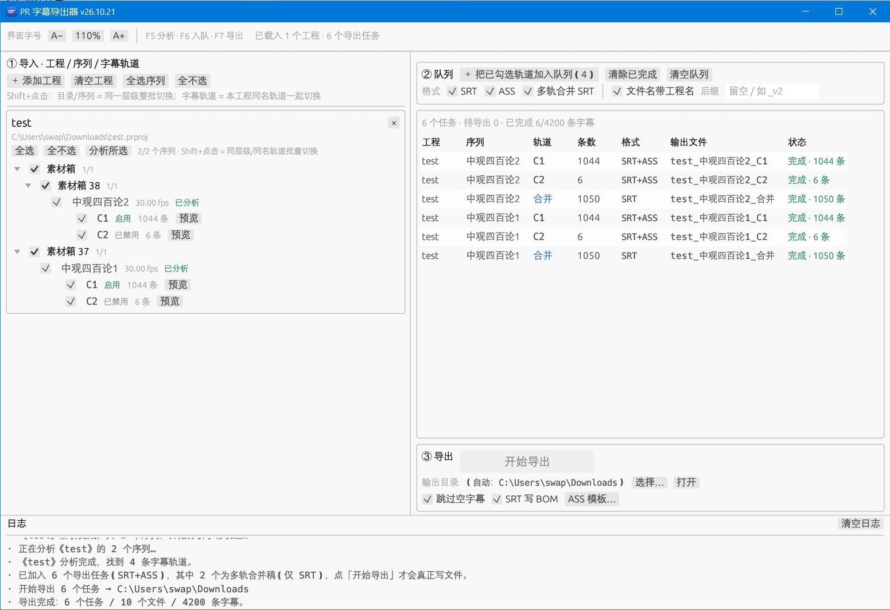

# PR 字幕导出器

从 **Premiere Pro 工程文件（.prproj）** 里直接读取序列的字幕轨道，批量导出为 **SRT / ASS** 字幕文件。

解决 Adobe Media Encoder 的老问题：AME 批量导出字幕时只会取最上面那条字幕轨道，不管它是否开启；本工具按工程内的真实轨道状态判断，**每条轨道单独判断、单独导出**。



## 功能

- **可同时载入多个工程**：拖 `.prproj` 到窗口任意位置，或点左侧「＋ 添加工程」多选；也可以把工程拖到 exe 图标上直接打开。
- **载入即分析**：拖入工程后自动列出序列并立刻开始分析字幕轨道，不需要再点按钮；后来新勾选的序列也会自动补分析。
- **保留工程面板的目录层级**：序列所在素材箱会按原样缩进展示（可展开/折叠），目录勾选框是三态的——点一下勾选/取消该目录下全部序列，只选了一部分时显示横杠。左面板里没有任何序列的纯媒体素材箱会自动隐藏。
- **序列按名字自然排序**：`序列2` 排在 `序列10` 前面，而不是字典序。
- **Shift+点击 = 按层级批量**：按住 Shift 点目录或序列的勾选框，只影响**同一层级**的兄弟节点（同一素材箱里的其它目录/序列一起切换，目录仍连同自己的子级）；点的是字幕轨道时，则把**本工程所有序列里的同名轨道**（如全部 `C2`）一起勾选/取消。想整个工程一刀切，可以点工程卡片里的「全选 / 全不选」，或对根层级的节点用 Shift。
- **按轨道真实启用状态识别**：读取每条字幕轨道的输出开关（`IsMuted`），默认只勾选**已启用**的轨道；想连禁用轨道一起导出也可以手动勾上。
- **SRT + ASS 同时导出**：勾选需要哪些格式即可，一次导出两种文件。
- **ASS 模板可改可存**：内置一份 1080p 模板，可在程序内直接编辑、保存，也可从文件载入 / 另存为。模板决定 `[Script Info]`、`[V4+ Styles]`（字体、字号、描边、位置…）。
- **文件名后缀**：可指定字符串追加到文件名尾部（如 `_v2`、`-重制`），默认为空。
- **智能轨道命名**：某个序列只导出 **1 条**字幕轨道时，文件名不带轨道名；导出 **多条**时才加 `C1`/`C2`，避免同名互相覆盖。
- **多轨合并稿**：某个序列勾了**多条**字幕轨道时，除了逐轨输出，还会额外输出一份 `…_合并.srt`——把所有选中轨道按时间排成一条线，**起止时间与文本都相同**的条目只留一条。对应 PR 里「完整讲话放 C1、单独补录的几句放 C2（甚至禁用 C2）」的场景，直接拿到一份完整字幕稿。合并稿只出 SRT，可在导出队列里关掉「多轨合并 SRT」。
- **批量导出队列**：勾选的轨道 →「加入队列」→ 只生成任务，不写文件；点「开始导出」才真正写盘。每个任务显示序列、轨道、条数、格式、输出文件、状态。
- **预览**：每条轨道可「预览」，在 SRT / ASS 之间切换查看生成结果。
- **设置自动记住**：导出格式、文件名后缀、输出目录、跳过空字幕 / 含工程名 / BOM 这些选项，改动后自动保存，下次启动自动恢复；设置文件也可以直接用记事本改。
- **界面可缩放**：`Ctrl` + `+` / `-` 整体放大缩小，`Ctrl+0` 恢复 100%；工具栏里也有 `A− 110% A+` 按钮。默认 110%。
- **界面按三步排布**：左侧「① 导入」负责选什么——加工程、清空、全选/全不选序列，以及工程 / 序列 / 轨道树；右侧自上而下三块等宽的区域：「② 队列」（格式与文件名规则 + 入队 / 清除已完成 / 清空队列按钮）、任务表、「③ 导出」（输出目录、跳过空字幕、SRT BOM、ASS 模板 + 加宽的蓝色「开始导出」主按钮）。
- 快捷键：`Ctrl+O` 添加工程、`F5` 分析所选、`F6` 加入队列、`F7` 开始导出。
- 附带命令行模式 `prsrt-cli.exe`，便于脚本化批量处理。

## 使用方法

1. 双击 `PR字幕导出器.exe`。
2. 把 `.prproj` 拖进窗口（可多个）。
3. 等待左侧自动分析完成（序列旁显示「已分析」）；不需要导出的序列可以取消勾选。按住 Shift 点目录/序列的勾选框 = 同层级一起切换，点轨道勾选框 = 本工程同名轨道一起切换。
4. 检查每条序列下的字幕轨道（`C1`、`C2`…），默认已勾选启用中的轨道。
5. 到右侧「② 队列」里选导出格式（SRT / ASS）与文件名规则（是否带工程名、后缀），多轨序列想少一份合并稿就取消「多轨合并 SRT」；这些选项在**点入队时**生效。
6. 点「＋ 把已勾选轨道加入队列」，下方的任务表会列出即将产出的文件；旁边的「清除已完成」「清空队列」用来打扫列表。
7. 在「③ 导出」里确认输出目录（及跳过空字幕、SRT 写 BOM、ASS 模板），点蓝色的「开始导出」。

> 输出目录默认取第一个工程所在目录，导出时自动创建。一旦手动选过目录，就会被记住。

设置文件：`%APPDATA%\PRSubtitleExporter\settings.ini`（`key=value` 文本，可手改；`zoom=1.10` 即 110% 字号）。

命令行模式：

```bat
prsrt-cli.exe D:\字幕输出 "D:\工程A.prproj" "D:\工程B.prproj" --formats srt,ass --suffix _v2
```

选项：`--formats srt|ass|srt,ass`、`--suffix 字符串`、`--template 模板.ass`、`--no-merged`（不输出多轨合并稿）。
只导出各序列中**已启用**的字幕轨道，命名规则与界面一致；某序列有多条轨道时默认额外输出 `…_合并.srt`。

> 界面里的「分析所选」按钮仍然保留：如果在 Premiere 里改了轨道开关、需要重新读取状态，点它重跑一次即可（平时不用点，载入时已自动分析）。

## ASS 模板

- 位置：`%APPDATA%\PRSubtitleExporter\ass_template.ass`（首次运行自动生成；界面里点「ASS 模板…」可直接改）。
- `{{EVENTS}}`：单独占一行时，会被替换成全部 `Dialogue:` 行；不写这个标记则字幕追加到文件末尾。
- `{{TITLE}}` = `工程名 - 序列名`；另有 `{{PROJECT}}` / `{{SEQUENCE}}`。
- 字幕行的样式名**自动取** `[V4+ Styles]` 里第一条 `Style:` 的名字，所以换样式名不必改别处。
- 以 `;` 开头的注释行原样保留，不做占位符替换。
- 字幕里的换行会转成 ASS 的 `\N`。

## 原理（为什么 AME 会漏、这个工具为什么不会）

`.prproj` 本质是 **gzip 压缩的 XML**。工程里所有对象是平铺在 `<PremiereData>` 下的一张对象图，用 `ObjectID` / `ObjectUID` 互相引用：

```
Sequence
  └─ TrackGroups / TrackGroup(Second) → DataTrackGroup        ← 字幕轨道组
        └─ Tracks / Track(ObjectURef) → CaptionDataClipTrack
              ├─ ClipTrack/Track/IsMuted = true               ← 该轨道被关闭输出
              └─ ClipItems/TrackItems/TrackItem(ObjectRef) → CaptionDataClipTrackItem
                    ├─ TrackItem/Start, End                    ← 时间（tick）
                    └─ BlockVector → Block → FormattedTextData ← 字幕文本（base64）
```

几个踩过的坑：

1. **时间单位**：Premiere 用 tick，`1 秒 = 254016000000 tick`；SRT 换算成毫秒、ASS 换算成百分秒，都四舍五入。
2. **轨道启用状态**：字幕轨道的「眼睛」开关写成 `<IsMuted>true</IsMuted>`（视频轨同一标记）。AME 不看这个标记、直接取最上面的轨道，所以导出结果和预期不符；本工具按每条轨道自己的标记判断。
3. **字幕文本是二进制**：`FormattedTextData` 是 base64 编码的 Adobe 自定义 FlatBuffer，正文是该块里最后一个「长度前缀 + UTF-8」字符串（前面还有 `AnimationType`、字体名等字符串，所以不能随便抓）。
4. **文本块去重**（最隐蔽的一个）：内容完全相同的字幕块，Premiere 只保存一份，其余 `FormattedTextData` 内容为空、只剩 `BinaryHash`。如果不去按 `BinaryHash` 回查，会漏掉大量字幕（测试工程里直接漏掉整整一个序列）。
5. **序列在面板里的位置是间接存的**：真正在工程面板里显示的序列项是
   `ClipProjectItem → MasterClip → AudioClip/VideoClip → *SequenceSource → <Sequence ObjectURef>`，
   名字一般来自 `<Sequence><Name>`（面板项名可能还是旧的）。只按 `<Sequence>` 找是找不到它属于哪个素材箱的，
   要沿 `ObjectRef` 把这条链走通，才能还原目录层级。
6. `\r` 是字幕内的换行，导出时规范成 SRT 的换行 / ASS 的 `\N`；空文本条目默认跳过。

## 从源码构建

需要 Rust（GNU 工具链即可）。本项目在 `x86_64-pc-windows-gnu` 下验证通过：

```bat
build.bat
cargo test
```

产物：`target\release\pr-subtitle-exporter.exe`（GUI）、`target\release\prsrt-cli.exe`（命令行）。

说明：

- 依赖走 `.cargo/config.toml` 里配置的国内镜像（rsproxy.cn），如需直连 crates.io 可删掉该文件。
- GNU 工具链需要 `as.exe` / `dlltool.exe` 等 mingw 工具；`build.bat` 优先使用本机 `C:\tools\w64dk2\w64devkit`，否则退回 rustup 自带目录。
- 依赖：`eframe/egui`（界面）、`roxmltree`（XML）、`flate2`（gzip，纯 Rust 后端）、`base64`、`rfd`（文件对话框）。
- 图标与版本信息由 `build.rs` 调用 `windres` 编译 `assets/app.rc` 嵌入 exe；找不到 `windres` 时只跳过图标，不影响编译。
  图标本身可以用 `python tools/gen_icon.py` 重新生成（纯脚本绘制，无第三方依赖）。
- 版本号规则 `YY.MM.DD`（例：`26.10.21`），**每次编译**由 `build.rs` 取当天日期自动生成，不需要手改任何文件。
  显示在窗口标题（`PR 字幕导出器 v26.10.21`）、启动日志第一行，也写进 exe 属性 → 详细信息；命令行 `prsrt-cli -V` 可查。
  需要指定固定版本时加环境变量：`set PRSRT_VERSION=26.10.21 && build.bat`。
  注意 `build.rs` 已给 `src` 下所有 `.rs` 登记了 `rerun-if-changed`，所以改了源码重新编译，版本号一定会跟着刷新。

## 已知限制

- 只支持以 gzip/XML 存储的 `.prproj`（Premiere CS4 以后都是这种格式）；更老的二进制工程不支持。
- 中文字体从系统读取（等线 / 黑体 / 微软雅黑 / 宋体），缺失时界面中文会显示异常。
- 界面缩放到很大（如 150%+）时，窗口建议同时拉大一些，否则内容会换行得很密。
- 只导出字幕文本与时间轴；SRT 不承载样式，ASS 的样式来自模板（不读取 PR 工程里每条字幕的独立样式）。
- 合并稿只输出 SRT（不带样式）；去重只认「起止时间 + 文本完全相同」，时间差一帧或文字改了标点的两条会都保留。
- 超大工程（几百 MB）分析时解析整份 XML，会有几秒等待；分析在后台线程进行，界面不会卡死。

## 许可证

[MIT](LICENSE)
